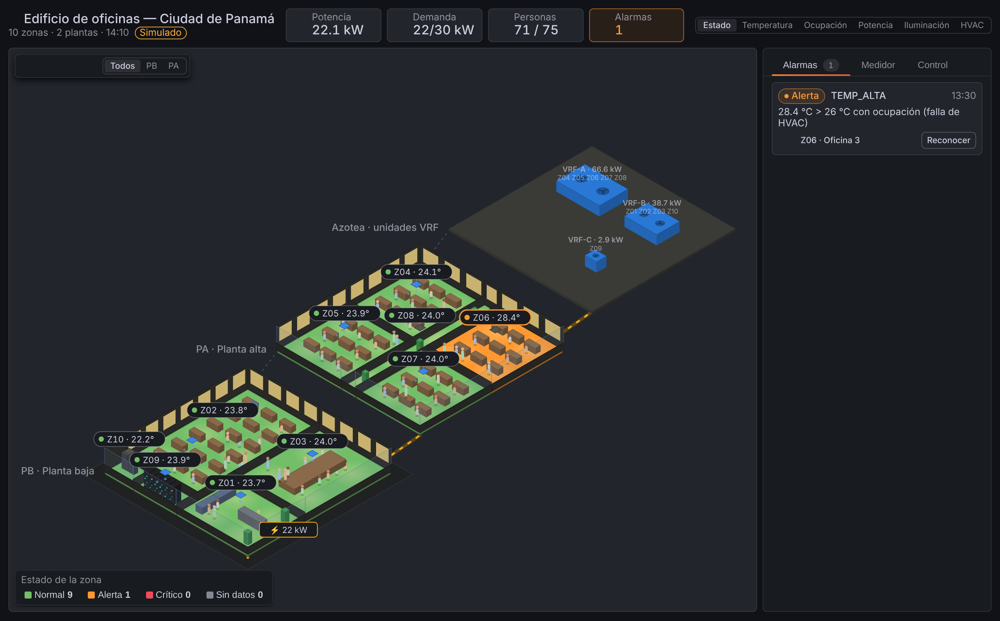

# EMS digital para edificio inteligente — Proyecto 2

UTP · Facultad de Ingeniería Eléctrica · Producción de la Energía Eléctrica (0877) · II Semestre 2026

Sistema de Gestión de Energía (EMS) para el edificio de oficinas del proyecto en **Ciudad de Panamá**
(2 plantas, 800 m², 10 zonas, 3 sistemas VRF), con los parámetros del modelo **OpenStudio/EnergyPlus**
del equipo (`data/energyplus/`, clima EPW Panamá-Albrook TMYx 2011–2025): gemelo digital calibrado y
validado contra EnergyPlus (ASHRAE Guideline 14), sensores, ocupación, actuadores, cargas y medidor, control por reglas con histéresis,
respuesta a la demanda, MPC simplificado, pronóstico del día siguiente, alarmas, KPIs técnico-económicos
y plataforma IoT (MQTT + Node-RED + InfluxDB + Grafana).

- Plan y división del trabajo: [`docs/PLAN.md`](docs/PLAN.md)
- Contrato de interfaces (MQTT / InfluxDB / variables): [`docs/CONTRATO.md`](docs/CONTRATO.md)
- Encargo del agente de infraestructura: [`docs/AGENTE_INFRA.md`](docs/AGENTE_INFRA.md)
- Despliegue en Arch Linux (systemd): [`docs/DESPLIEGUE_ARCH.md`](docs/DESPLIEGUE_ARCH.md) · plantillas en `deploy/arch/`
- Resultados generados: [`resultados/RESUMEN.md`](resultados/RESUMEN.md)

## Arquitectura

```
clima ─┐                       ┌──────── Node-RED (reglas EMS, nodered/flows.json)
ocupac.├─► gemelo digital ──MQTT┤
       │   (ems/edificio.py)   └──────── comandos ─► actuadores (setpoint, HVAC, luces, enchufes)
       │          │
       │          └── InfluxDB ──► Grafana (tiempo real, zonas, alarmas, resultados)
       └─► escenarios offline (Python) ─► resultados/*.csv, *.png, RESUMEN.md
```

| Módulo | Qué hace |
|---|---|
| `ems/edificio.py` | Modelo térmico RC por zona, termostato on/off con histéresis, DCV, cargas, sensores con fallas, medidor (P, Q, S, FP, V, I, demanda 15 min) |
| `ems/control.py` | Línea base, Reglas (ocupación + vacancia + pre-enfriamiento + luz natural + standby), Reglas+DR (rotación de compresores + deslastre escalonado), MPC simplificado; supervisor de alarmas y modo seguro |
| `ems/pronostico.py` | Pronóstico día siguiente: regresión, persistencia, SARIMAX; MAE / RMSE / MAPE |
| `ems/kpi.py` | Energía, pico, confort, CO₂, VPN, TIR, payback, ROI, costo del kWh evitado, escalamiento Panamá |
| `ems/escenarios.py` | Comparación de escenarios, 10 pruebas normales/anómalas con criterios, sensibilidad |
| `ems/live.py` | Modo en vivo por MQTT (+ InfluxDB) |
| `ems/energyplus_bridge.py` | Puente Python–EnergyPlus (pyenergyplus) con el mismo controlador |
| `nodered/src/*.js` → `flows.json` | Las mismas reglas en Node-RED; `ems/nodered.py` verifica paridad exacta con Python |
| `ems/validacion.py` | Validación y calibración contra EnergyPlus: usos finales, pico, NMBE y CV(RMSE) horarios (ASHRAE G14) |
| `tools/importar_energyplus.py` | Importa los resultados del modelo E+ (eplusout.sql, EPW) a `data/` |
| `grafana-ems-panel/` | Panel de Grafana propio: edificio inteligente en 3D (2 plantas, 10 zonas, azotea con 3 unidades VRF) con interiores animados, 6 vistas, alarmas, medidor y **control del edificio** (overrides por zona y parámetros del EMS vía Node-RED); modo demostración o datos de InfluxDB |
| `nodered/src/override.js`, `http_control.js` | Control manual: overrides con prioridad sobre las reglas y endpoint `POST /ems/control` con CORS |

## Panel 3D de Grafana



Ver [`grafana-ems-panel/README.md`](grafana-ems-panel/README.md) (compilar con `npm ci && npm run build`).

## Uso rápido

```bash
pip install -r requirements.txt
```

```bash
python -m ems todo          # todo el análisis → resultados/ (≈1 min)
```

```bash
pytest -q                   # 29 pruebas
```

Comandos individuales: `auditoria`, `pronostico`, `escenarios`, `pruebas`, `sensibilidad`, `paridad`,
`live`, `exportar`, `energyplus`. Cualquier parámetro de `config/edificio.yaml` se puede variar sin editar el archivo:

```bash
python -m ems --set ems.limite_demanda_kw=27 --set tarifa.precio_punta_usd_kwh=0.28 escenarios
```

### Modo en vivo (demo)

Con la plataforma de `infra/` levantada (ver `docs/AGENTE_INFRA.md`) el servicio `simulador` arranca solo.
Sin Docker, con un Mosquitto local:

```bash
python tools/nodered_stub.py --port 1883 &          # sustituto de Node-RED (mismo JS)
```

```bash
python -m ems live --control externo --velocidad 300
```

`--control interno` usa las reglas Python sin Node-RED; `--control baseline` simula el edificio sin EMS.

### EnergyPlus

```bash
export ENERGYPLUS_DIR=/ruta/EnergyPlus-24-2-0
```

```bash
python -m ems energyplus --idf modelo_10zonas.idf --epw PAN_Tocumen.epw --mapa config/energyplus_mapa.yaml
```

`config/energyplus_mapa_5zone.yaml` permite probar el puente con el ejemplo `5ZoneAirCooled.idf` de EnergyPlus.

## Modelo del edificio y validación contra EnergyPlus

Parámetros tomados del modelo del equipo (`EMS_Edificio_Ultima simulacion`): geometría (floorplan), cargas
internas, horarios, envolvente (muro U 0.86, techo U 0.27, vidrio simple U 6.42 / SHGC 0.25, WWR 69 %),
terminales y sistemas VRF autodimensionados y clima EPW de Panamá. Los cuatro parámetros efectivos del modelo
RC (masa térmica, fracción solar convectiva, radiación al cielo y latente del serpentín) se calibran contra la
serie horaria de E+ (`python -m ems calibrar`).

| Uso final anual | EnergyPlus | Gemelo digital | Diferencia |
|---|---|---|---|
| Enfriamiento | 66.8 MWh | 61.4 MWh | −8.1 % |
| Ventiladores | 15.6 MWh | 15.6 MWh | −0.2 % |
| Iluminación | 17.9 MWh | 18.7 MWh | +4.6 % |
| Equipos | 43.8 MWh | 43.8 MWh | 0.0 % |
| **Total** | **144.0 MWh** | **139.4 MWh** | **−3.2 %** |

Serie horaria anual: NMBE 3.2 %, CV(RMSE) 23.0 % → **cumple ASHRAE Guideline 14** (±10 %, ≤ 30 %).
Pico anual: 51.9 kW (E+) frente a 53.5 kW. `python -m ems validar` regenera la tabla y la figura.

## Resultados principales (4 semanas tipo con el EPW, `python -m ems todo`)

| Escenario | Energía 4 sem. (kWh) | Demanda máx. 15 min (kW) | Confort (%) | Ahorro (%) | Pico evitado (kW) | Payback (años) |
|---|---|---|---|---|---|---|
| Línea base (operación del modelo E+) | 10 654 | 51.2 | 96.4 | — | — | — |
| Reglas | 7 225 | 37.3 | 97.4 | 32.2 | 13.9 | 2.7 |
| Reglas + DR (límite 30 kW) | 6 994 | 35.9 | 97.4 | 34.4 | 15.3 | 2.5 |
| MPC | 6 935 | 33.9 | 97.4 | 34.9 | 17.3 | 2.4 |

Los ahorros vienen de: setpoint 24 °C con ocupación (el modelo usa 22 °C), ventiladores en automático fuera de
ocupación (en el modelo 6 terminales ventilan 24 h), apagado de luces y corte de standby sin ocupación
(incluidos los equipos que el horario del modelo deja encendidos sábado y domingo por la mañana) y
aprovechamiento de luz natural.

Pronóstico día siguiente (regresión): sobre el año de EnergyPlus MAE 0.56 kW, RMSE 0.73 kW (serie determinista
de horarios fijos); sobre el gemelo con ocupación estocástica MAE 0.89 kW, RMSE 1.26 kW. Pruebas: 10/10
superadas, confiabilidad de la lógica 100 %, latencia de decisión < 1 ms (p99); lazo MQTT medido
comando→actuador ≈ 12 ms de media. Detalle en `resultados/RESUMEN.md`.

## Supuestos y limitaciones

- Datos de sensores **simulados** con el EPW de Panamá y los horarios del modelo E+ (más variación aleatoria de
  ocupación). La serie de EnergyPlus es determinista y favorece al pronóstico; con datos reales de medidor se
  esperan errores mayores.
- El modelo E+ usa la temperatura de terreno por defecto de EnergyPlus (**18 °C**); en Panamá el terreno está a
  26–28 °C (el propio IDF lo trae en `Site:GroundTemperature:FCfactorMethod`). Se replica para la calibración y
  se evalúa en la sensibilidad (`edificio.t_suelo_c`); conviene corregirlo en OpenStudio. Con 18 °C la losa
  enfría la planta baja de noche: el EMS incluye una regla de protección por baja temperatura (ventilador con
  aire exterior, sin compresor).
- Tarifas, CAPEX, factor de emisión y área de oficinas de Panamá son **supuestos documentados** en
  `config/edificio.yaml` y `ems/kpi.py`; deben contrastarse con el pliego tarifario ASEP vigente, cotizaciones
  locales y datos de SNE/INEC antes del informe final.
- El modelo RC 1R1C por zona no representa humedad explícitamente (se usa SHR del equipo DX).
- El puente EnergyPlus está implementado pero **no se ha ejecutado** en este entorno (ver `docs/PLAN.md`).
