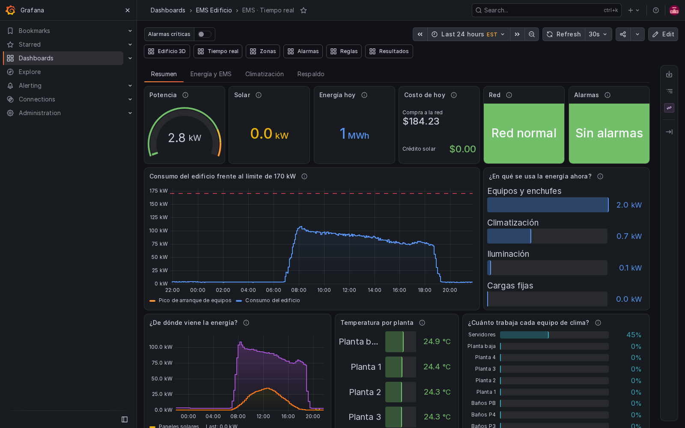
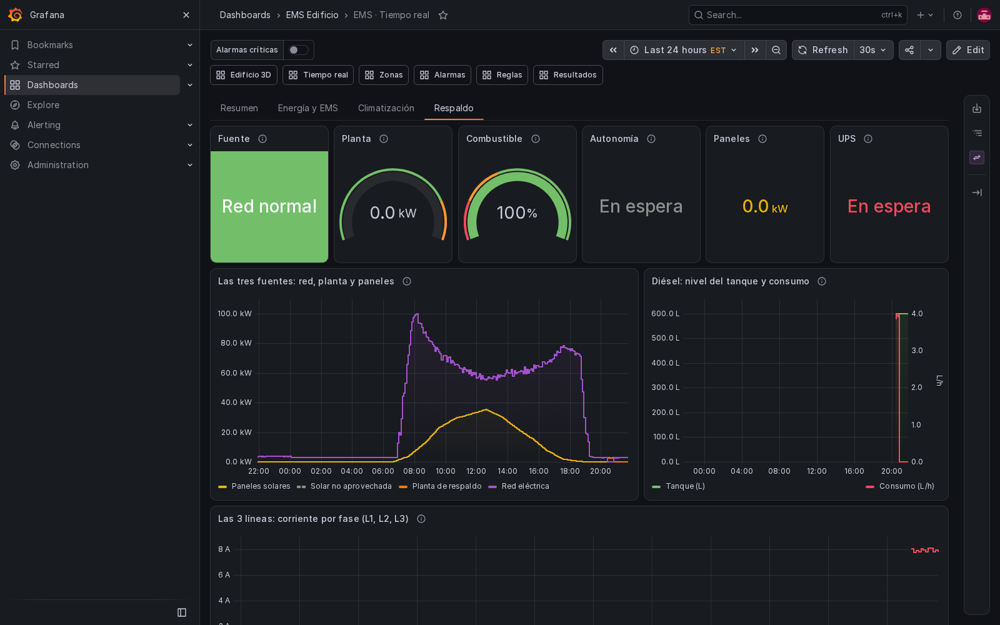
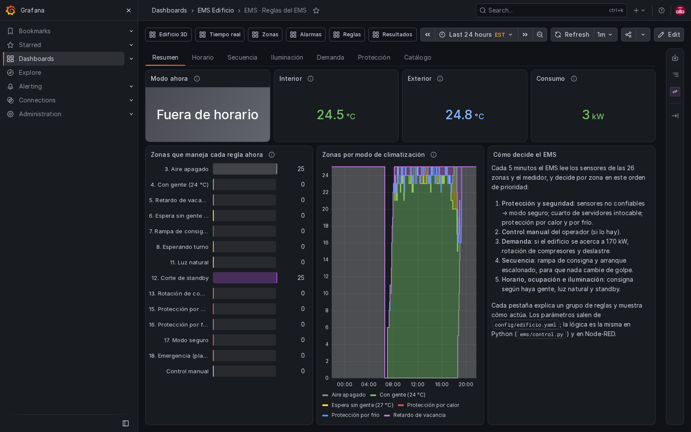
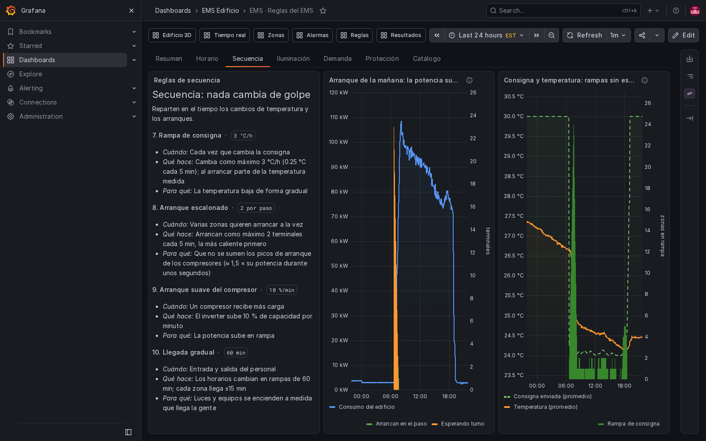
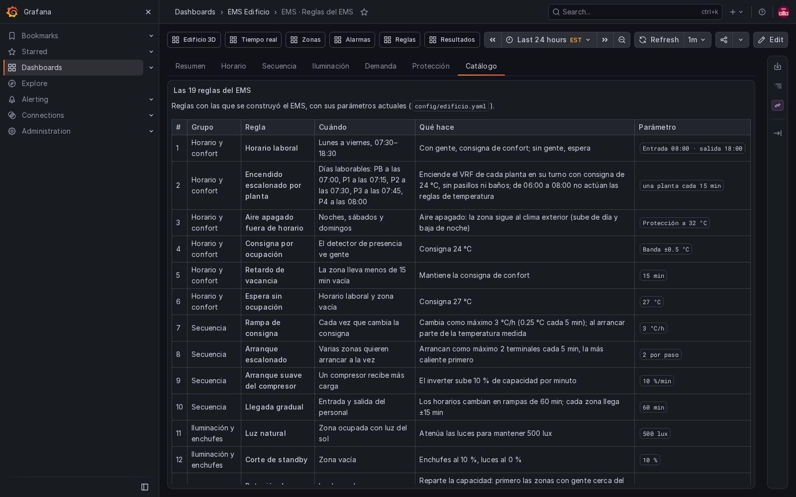
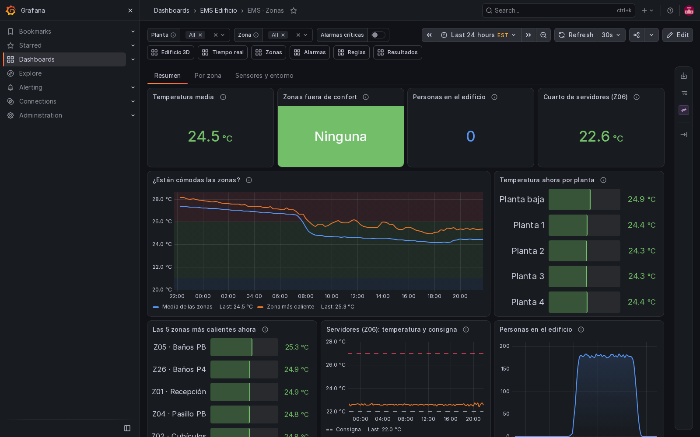
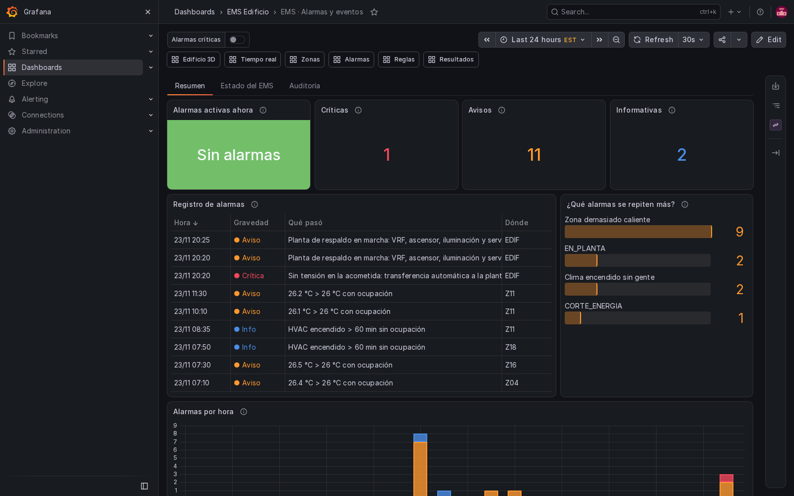
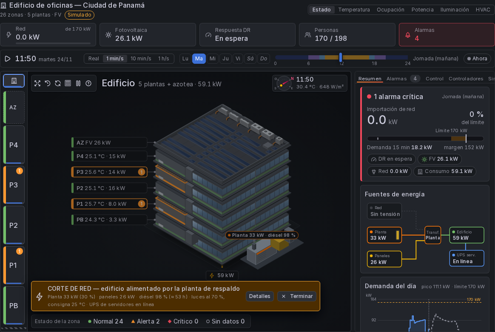

# EMS digital para edificio inteligente — Proyecto 2

UTP · Facultad de Ingeniería Eléctrica · Producción de la Energía Eléctrica (0877) · II Semestre 2026

Sistema de Gestión de Energía (EMS) para el edificio de oficinas del proyecto en **Ciudad de Panamá**
(5 plantas, 2000 m², 26 zonas acondicionadas, 6 sistemas VRF y 5 PTAC; variante con 55 kWp fotovoltaicos),
con los parámetros del modelo **OpenStudio/EnergyPlus** del equipo (`Edificio_Sin_EMS` y `Edificio_Sin_EMS_ConPV`,
importados en `data/energyplus/`, clima EPW Panamá-Albrook TMYx 2011–2025).

Qué incluye:

- **Gemelo digital** del edificio validado contra EnergyPlus (ASHRAE Guideline 14): modelo térmico de aire y
  masa por zona, compresores inverter con rampa y pico de arranque, medidor trifásico con las tres líneas.
- **EMS por reglas** (19 reglas, idénticas en Python y Node-RED): horario y ocupación, encendido escalonado por
  planta, rampa de consigna, luz natural, corte de standby, límite de demanda, protecciones y modo emergencia.
- **Planta de respaldo**: generador diésel de 110 kW con transferencia automática, UPS de los servidores y
  paneles solares en paralelo durante un corte, con toma de carga escalonada.
- **Plataforma IoT** (MQTT + Node-RED + InfluxDB + Grafana): seis dashboards con pestañas y un panel 3D propio.
- **Resultados y negocio**: escenarios comparados, pronóstico, KPIs técnico-económicos (VPN, TIR, recuperación).
- **Operación segura**: HTTPS, órdenes sólo con sesión, auditoría, copias de seguridad y alertas.

- Plan y división del trabajo: [`docs/PLAN.md`](docs/PLAN.md)
- Contrato de interfaces (MQTT / InfluxDB / variables): [`docs/CONTRATO.md`](docs/CONTRATO.md)
- Encargo del agente de infraestructura: [`docs/AGENTE_INFRA.md`](docs/AGENTE_INFRA.md)
- Despliegue en Arch Linux (systemd): [`docs/DESPLIEGUE_ARCH.md`](docs/DESPLIEGUE_ARCH.md) · plantillas en `deploy/arch/`
- Resultados generados: [`resultados/RESUMEN.md`](resultados/RESUMEN.md)
- Informe técnico: [`docs/INFORME.md`](docs/INFORME.md) · hoja de ruta a un edificio real: [`docs/PILOTO.md`](docs/PILOTO.md)
- Planta de respaldo (generador, UPS y paneles en un corte): [`docs/PLANTA_RESPALDO.md`](docs/PLANTA_RESPALDO.md)
- Seguridad y operación (HTTPS, auditoría, copias, alertas): [`deploy/seguridad/README.md`](deploy/seguridad/README.md)

## Arquitectura

```
clima ─┐                       ┌──────── Node-RED (reglas EMS, nodered/flows.json)
ocupac.├─► gemelo digital ──MQTT┤
       │   (ems/edificio.py)   └──────── comandos ─► actuadores (setpoint, HVAC, luces, enchufes)
       │          │
       │          └── InfluxDB ──► Grafana (tiempo real, zonas, alarmas, resultados)
       └─► escenarios offline (Python) ─► resultados/*.csv, *.png, RESUMEN.md
```

| Módulo | Qué hace |
|---|---|
| `ems/edificio.py` | Modelo térmico 2R2C por zona (aire + masa), compresores inverter con rampa, termostato con histéresis, DCV, cargas, sensores con fallas, medidor (P, Q, S, FP, V, I, demanda 15 min) y planta de respaldo (generador, UPS, paneles en paralelo) |
| `ems/control.py` | Línea base, Reglas (19 reglas: horario, ocupación, aire apagado fuera de horario, pre-enfriamiento escalonado, rampa de consigna, luz natural, standby, protecciones y modo emergencia), Reglas+DR (rotación de compresores + deslastre), MPC simplificado; supervisor de alarmas y modo seguro |
| `ems/pronostico.py` | Pronóstico día siguiente: regresión, persistencia, SARIMAX; MAE / RMSE / MAPE |
| `ems/kpi.py` | Energía, pico, confort, CO₂, VPN, TIR, payback, ROI, costo del kWh evitado, escalamiento Panamá |
| `ems/escenarios.py` | Comparación de escenarios, 10 pruebas normales/anómalas con criterios, sensibilidad |
| `ems/live.py` | Modo en vivo por MQTT (+ InfluxDB) |
| `ems/energyplus_bridge.py` | Puente Python–EnergyPlus (pyenergyplus) con el mismo controlador |
| `nodered/src/*.js` → `flows.json` | Las mismas reglas en Node-RED; `ems/nodered.py` verifica paridad exacta con Python |
| `ems/validacion.py` | Validación y calibración contra EnergyPlus: usos finales, pico, NMBE y CV(RMSE) horarios (ASHRAE G14) |
| `tools/importar_energyplus.py` | Importa el modelo E+ (in.idf, eplusout.sql, floorplan.json, EPW; con y sin FV) a `data/`: series de validación y parámetros de zonas, envolvente, VRF/PTAC y FV (`modelo_parametros.json`) |
| `grafana-ems-panel/` | Panel de Grafana propio: edificio inteligente en 3D (5 plantas, 26 zonas, azotea con 6 unidades VRF y paneles FV) con interiores animados, 6 vistas, barra de tiempo (hora, día, velocidad), alarmas, medidor, **control del edificio**, **simulación de alarmas y accidentes** y **«¿qué pasaría si…?»** (confort ISO 7730, rendimiento, riesgo de servidores); modo demostración o datos de InfluxDB |
| `nodered/src/override.js`, `http_control.js` | Control manual: overrides con prioridad sobre las reglas y endpoint `POST /ems/control` con CORS |
| `ems/eventos.py` | Eventos simulados en el gemelo (incendio, corte de energía con planta de respaldo, falla de la planta, falla VRF/terminal, puerta abierta, sensor, ola de calor, sobreocupación, pico de carga) |
| `tools/generar_dashboard_reglas.py`, `tools/dashboards_pestanas.py` | Generan los dashboards de Grafana con pestañas (esquema v2) desde `config/edificio.yaml` y `deploy/arch/grafana/dashboards-src/` |
| `deploy/seguridad/`, `deploy/arch/ems-backup.*`, `deploy/arch/grafana/alertas-ems.yaml` | HTTPS con proxy (las órdenes sólo pasan con sesión de Grafana), copia de seguridad diaria y reglas de alerta |

## Dashboards de Grafana

Seis dashboards con la misma barra de enlaces y pestañas: **Edificio 3D** (gemelo en vivo a pantalla completa),
**Tiempo real** (Resumen · Energía y EMS · Climatización · Respaldo), **Zonas**, **Alarmas** (con la auditoría de
órdenes), **Reglas** (las 19 reglas del EMS, sus parámetros y cuándo actúa cada una) y **Resultados** (con la
pestaña «Negocio»: ahorro anual, inversión, recuperación, VPN, TIR y flujo de caja a 10 años).

### Capturas

| Tiempo real: consumo en escalones, las tres fuentes y las 3 líneas | Respaldo: planta, combustible, UPS y ficha de diseño |
|---|---|
|  |  |

| Reglas: qué hace el EMS ahora | Reglas → Secuencia: arranque escalonado y rampas |
|---|---|
|  |  |

| Catálogo de las 19 reglas | Zonas | Alarmas y auditoría |
|---|---|---|
|  |  |  |

## Panel 3D de Grafana

| Operación normal (planta 2) | Corte de red: planta de respaldo y paneles |
|---|---|
|  |  |

El panel dibuja el edificio de 5 plantas con sus 26 zonas, la azotea con los VRF y los paneles, y la planta de
respaldo junto a la fachada (grupo electrógeno, tanque de diésel y tablero de transferencia).

Ver [`grafana-ems-panel/README.md`](grafana-ems-panel/README.md) (compilar con `npm ci && npm run build`).

## Uso rápido

```bash
pip install -r requirements.txt
```

```bash
python -m ems todo          # todo el análisis → resultados/ (≈1 min)
```

```bash
pytest -q                   # 38 pruebas
```

Comandos individuales: `auditoria`, `pronostico`, `escenarios`, `pruebas`, `sensibilidad`, `paridad`,
`live`, `exportar`, `energyplus`. Cualquier parámetro de `config/edificio.yaml` se puede variar sin editar el archivo:

```bash
python -m ems --set ems.limite_demanda_kw=150 --set tarifa.precio_punta_usd_kwh=0.28 escenarios
```

### Modo en vivo (demo)

Con la plataforma de `infra/` levantada (ver `docs/AGENTE_INFRA.md`) el servicio `simulador` arranca solo.
Sin Docker, con un Mosquitto local:

```bash
python tools/nodered_stub.py --port 1883 &          # sustituto de Node-RED (mismo JS)
```

```bash
python -m ems live --control externo --velocidad 300
```

`--control interno` usa las reglas Python sin Node-RED; `--control baseline` simula el edificio sin EMS.

### EnergyPlus

```bash
export ENERGYPLUS_DIR=/ruta/EnergyPlus-24-2-0
```

```bash
python -m ems energyplus --idf data/energyplus/modelo/in.idf --epw data/clima/PAN_PO_Panama-Albrook.Gelabert.Intl.AP.783842_TMYx.2011-2025.epw
```

`config/energyplus_mapa_5zone.yaml` permite probar el puente con el ejemplo `5ZoneAirCooled.idf` de EnergyPlus.

## Modelo del edificio y validación contra EnergyPlus

Parámetros tomados de los modelos del equipo (`Edificio_Sin_EMS` y `Edificio_Sin_EMS_ConPV`) con
`tools/importar_energyplus.py`: geometría (floorplan.json: PB y P1–P4 de 20 × 20 m), cargas internas por zona,
horarios `BASE_*`/`TEMP_*` (el modelo sin EMS enfría a 22 °C las 24 h; baños a 24 °C), envolvente (muro U 2.48,
techo U 0.61, losa U 4.02, vidrio tintado U 5.71 / SHGC 0.50), 21 terminales VRF en 6 sistemas y 5 PTAC
autodimensionados, ascensor, FV y clima EPW de Panamá. El COP estacional y los parámetros efectivos del modelo
RC se calibran contra la serie horaria de E+ (`python -m ems calibrar`).

| Uso final anual | EnergyPlus | Gemelo digital | Diferencia |
|---|---|---|---|
| Enfriamiento | 318.9 MWh | 286.2 MWh | −10.3 % |
| Ventiladores | 74.9 MWh | 76.0 MWh | +1.6 % |
| Iluminación | 60.6 MWh | 60.9 MWh | +0.5 % |
| Equipos (incl. ascensor) | 98.1 MWh | 87.7 MWh | −10.6 % |
| **Total** | **552.5 MWh** | **521.4 MWh** | **−5.6 %** |

Serie horaria anual: NMBE 5.6 %, CV(RMSE) 13.5 % → **cumple ASHRAE Guideline 14** (±10 %, ≤ 30 %).
Pico anual: 132.7 kW (E+) frente a 114.3 kW. FV (variante ConPV): NMBE < 1 % frente a la generación de E+
(101 MWh/año). El gemelo usa un modelo de dos nodos por zona (aire + masa térmica) con compresores inverter en
rampa; para compararse con E+ usa el terreno a 18 °C del modelo original y para operar, 27 °C.
`python -m ems validar` regenera la tabla y la figura.

## Resultados principales (4 semanas tipo con el EPW, `python -m ems todo`)

Tarifa: 0,15672 USD/kWh, cargo por demanda de 15,03 USD/kW·mes y cargo fijo de 10,03 USD/mes. Sin paneles
(energía y demanda = consumo del edificio):

| Escenario | Energía 4 sem. (kWh) | Demanda máx. 15 min (kW) | Confort (%) | Ahorro (%) | Pico evitado (kW) | Ahorro anual (USD) | Payback (años) |
|---|---|---|---|---|---|---|---|
| Línea base (operación del modelo E+) | 43 632 | 131.6 | 100.0 | — | — | — | — |
| Reglas | 21 740 | 129.7 | 97.7 | 50.2 | 1.9 | 45 066 | 1.5 |
| Reglas + DR (límite 170 kW) | 21 740 | 129.7 | 97.7 | 50.2 | 1.9 | 45 066 | 1.5 |
| MPC | 21 620 | 139.8 | 98.2 | 50.4 | −8.2 | 43 495 | 1.6 |

Con paneles (energía y demanda de la acometida, netas de 7.3 MWh FV en las 4 semanas; ahorro frente a la
línea base con FV):

| Escenario | Energía de red (kWh) | Demanda máx. 15 min (kW) | Ahorro (%) | Pico evitado (kW) | Ahorro anual (USD) | Payback (años) |
|---|---|---|---|---|---|---|
| Línea base + FV | 36 323 | 112.2 | — | — | — | — |
| Reglas + FV | 16 251 | 111.3 | 55.3 | 0.9 | 43 534 | 1.6 |
| Reglas + DR + FV | 16 251 | 111.3 | 55.3 | 0.9 | 43 534 | 1.6 |
| MPC + FV | 16 132 | 126.6 | 55.6 | −14.5 | 41 012 | 1.7 |

Estrategia desplegada (Reglas + DR): VPN a 10 años ≈ 241 000 USD, TIR 68 %, 88 t de CO₂ evitadas al año.

Los ahorros de energía vienen de apagar el aire fuera de horario (el modelo sin EMS mantiene 22 °C las 24 h con
los ventiladores encendidos), del setpoint de 24 °C con ocupación, del apagado de luces y del corte de standby.

**Encendido de la mañana.** El EMS enciende el VRF de una planta cada 15 minutos (PB 7:00, P1 7:15, P2 7:30,
P3 7:45, P4 8:00), sin pasillos ni baños, y de 6:00 a 8:00 no actúan las reglas de temperatura
(`ems.arranque_por_planta`). De martes a viernes funciona bien: el pico queda en 80–97 kW y las oficinas están a
24 °C a las 8:00. **El lunes es el punto débil**: tras el fin de semana apagado el edificio amanece a 28–30 °C y
una hora no basta, así que el pico sube a ≈ 141 kW (casi el de no tener EMS) y las oficinas reciben a la gente a
26–27 °C. Por eso el pico evitado es de sólo 1,9 kW y el confort baja al 97,7 %. La alternativa ya implementada
es el arranque óptimo (cada zona empieza antes cuanto más caliente está, hasta 7 h antes, sin pasar de 90 kW):
deja el pico del lunes en 89 kW, el de las 4 semanas en 106 kW y el confort en 99,9 %, con un 1,4 % más de
energía. Se activa quitando el bloque `ems.arranque_por_planta` de `config/edificio.yaml`.

Pronóstico día siguiente (regresión ridge): sobre el año de EnergyPlus MAE 2.3 kW, RMSE 3.0 kW; sobre el gemelo
con ocupación estocástica MAE 2.6 kW, RMSE 5.5 kW (persistencia semanal 2.9 / 6.2 kW). Pruebas: 9/10 superadas:
falla la de ola de calor (P02), porque con el encendido a las 7:00 el confort queda 2,8 puntos por debajo del de
la línea base; con el arranque óptimo pasaban las 10. Latencia de decisión ≈ 4 ms (p99); paridad exacta
Python ⇄ Node-RED en 2016 pasos. Detalle en `resultados/RESUMEN.md`.

## Supuestos y limitaciones

- Datos de sensores **simulados** con el EPW de Panamá y los horarios del modelo E+ (más variación aleatoria de
  ocupación). La serie de EnergyPlus es determinista y favorece al pronóstico; con datos reales de medidor se
  esperan errores mayores.
- El modelo E+ usa la temperatura de terreno por defecto de EnergyPlus (**18 °C**); en Panamá el terreno está a
  26–28 °C. El gemelo opera con **27 °C** (`edificio.t_suelo_c`) y sólo usa 18 °C para compararse con E+
  (`edificio.t_suelo_energyplus_c`); conviene corregirlo también en OpenStudio.
- Tarifa única de **0,15672 USD/kWh** a todas las horas (`tarifa`), más el cargo por demanda.
- La planta de respaldo (110 kW, tanque de 600 L, UPS de 3 kVA) está dimensionada con la simulación del día de
  diseño; ver `docs/PLANTA_RESPALDO.md` para sus limitaciones (baja carga de noche y en fin de semana).
- Tarifas, CAPEX, factor de emisión y área de oficinas de Panamá son **supuestos documentados** en
  `config/edificio.yaml` y `ems/kpi.py`; deben contrastarse con el pliego tarifario ASEP vigente, cotizaciones
  locales y datos de SNE/INEC antes del informe final.
- El modelo 2R2C por zona integra la humedad sólo para informar la HR (el VRF no la controla).
- El puente EnergyPlus está implementado pero **no se ha ejecutado** en este entorno (ver `docs/PLAN.md`).
