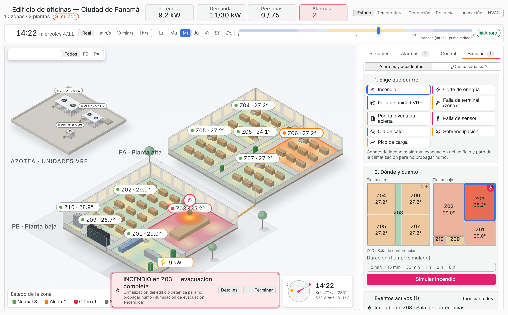
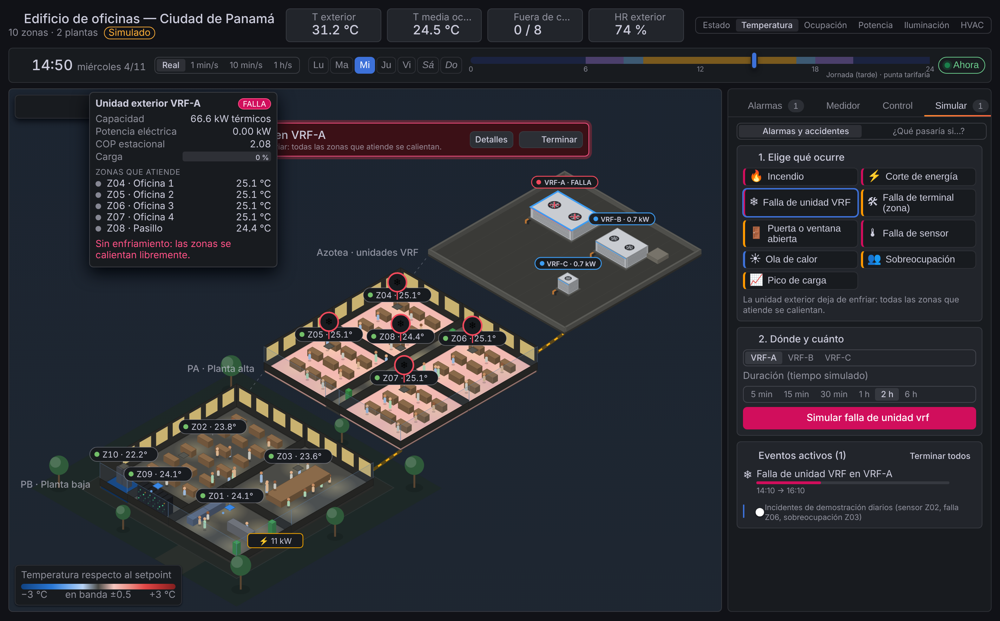
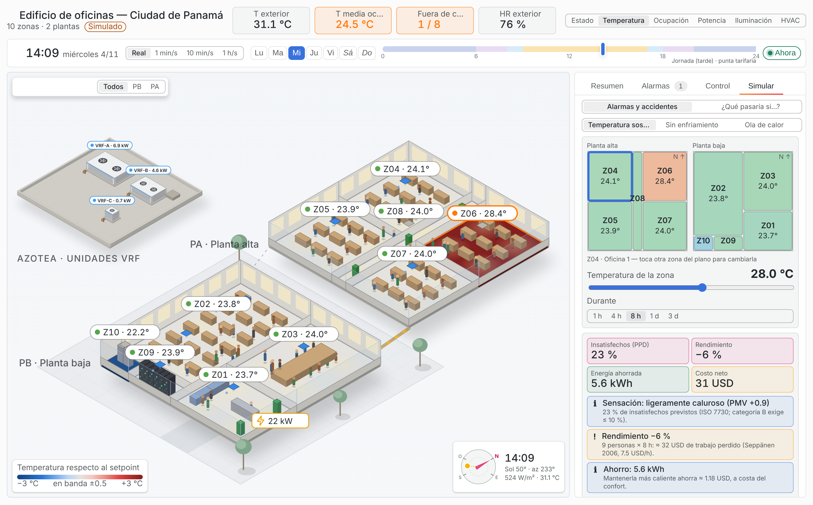
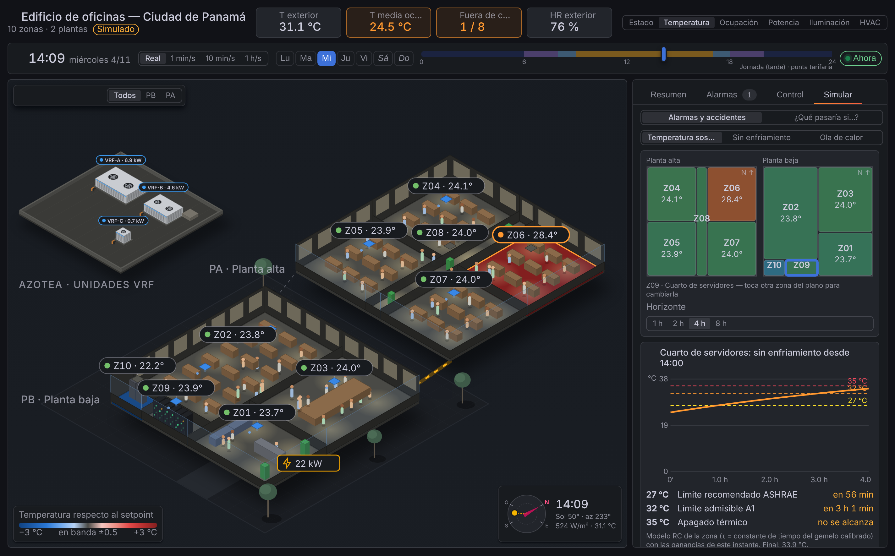
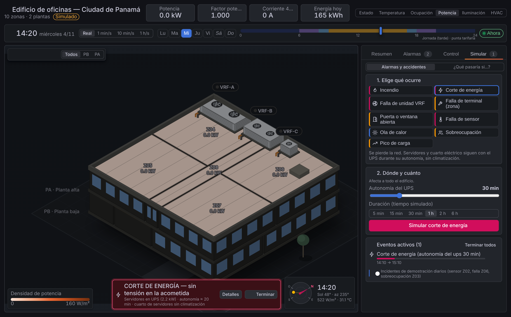
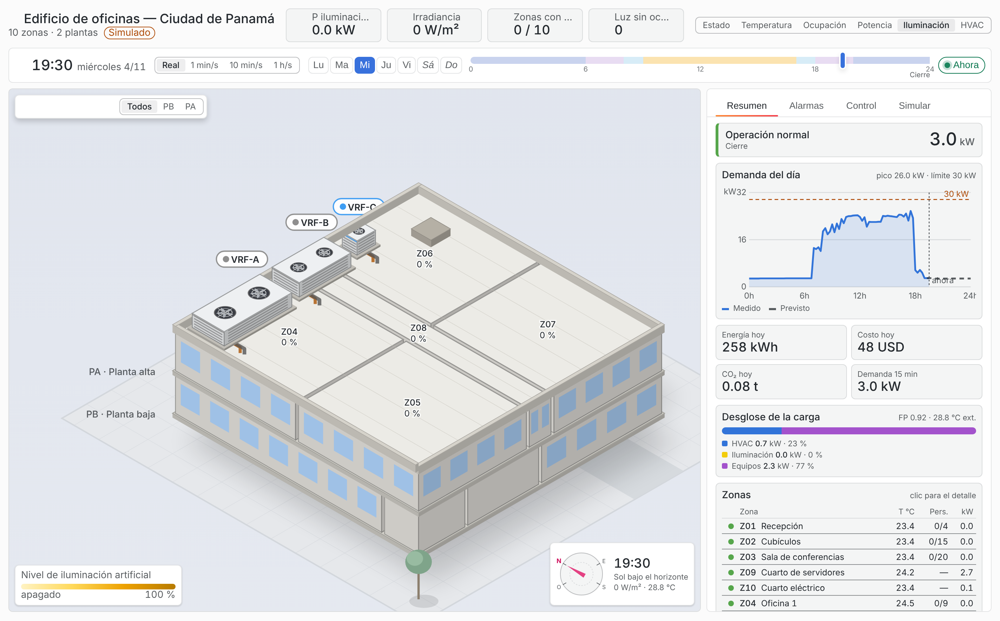

# EMS Edificio — panel de Grafana (`doctype02-ems-panel`)

Panel de Grafana con el **edificio inteligente del Proyecto 2 en 3D isométrico**, según el modelo
OpenStudio/EnergyPlus del equipo: 2 plantas de 20 × 20 m, 10 zonas y azotea con las 3 unidades exteriores VRF. Cada zona se colorea según la vista elegida y muestra el estado del
EMS (ocupación, HVAC, iluminación, potencia, alarmas). Reutiliza la base técnica del panel BMS
(`Doctype02/Plugin-BMS`): scaffolding de Grafana, encabezado de indicadores, insignias de estado,
sparklines y pantalla completa. El plano y los equipos son propios del edificio del EMS.


| Detalle y control de zona | Control del edificio (deslastre manual) |
|---|---|
|  |  |

| Incendio simulado (evacuación, HVAC detenido) | Falla de la unidad VRF-A (popup de la azotea) |
|---|---|
|  |  |

| ¿Qué pasaría si…? oficina a 28 °C durante 8 h | Servidores sin enfriamiento: minutos hasta cada umbral |
|---|---|
|  |  |

| Corte de energía (UPS) | Vista exterior de noche |
|---|---|
|  |  |

## Uso rápido

1. **Elige la hora** en la barra de tiempo: arrastra la hora del día (bandas de noche, jornada y punta
   tarifaria), cambia el día de la semana, pausa o acelera (tiempo real, 1 min/s, 10 min/s, 1 h/s).
   *Ahora* vuelve a la hora real de Panamá.
2. **Explora**: pasa el mouse por una zona o por una unidad VRF de la azotea (ventana con capacidad, carga,
   potencia, COP, estado y zonas que atiende); clic en una zona para su detalle y control.
3. **Resumen** (pestaña por defecto): estado general, curva de demanda del día (medida y prevista) frente al
   límite, energía, costo y CO₂ del día, desglose HVAC/iluminación/equipos, tabla de zonas y medidor general.
4. **Controla** (pestaña *Control*): plano de zonas con su temperatura, parámetros del EMS con su efecto
   estimado, acciones rápidas de 5 min a 1 h, zonas en manual con el tiempo restante.
5. **Simula** (pestaña *Simular*): alarmas y accidentes, y «¿qué pasaría si…?».
6. Botón **?** del escenario: guía breve.

## Qué muestra

- **Edificio 3D** (SVG, sin dependencias). Dos formas de verlo; se gira en pasos de 90° y se puede mostrar
  un solo piso (PB, P1, P2):
  - _En corte_ (vista explotada): cada piso escalonado, con muros de fondo completos y ventanas, fachada de
    vidrio con antepecho, divisiones bajas y el **interior de cada zona**: escritorios, mesa de reuniones,
    estaciones de trabajo de los cubículos, escritorios de las oficinas, mesa de la sala de conferencias,
    mostrador y sofás de la recepción, fila de racks del cuarto de servidores, tableros del cuarto eléctrico
    y plantas del pasillo.
  - _Exterior_: pisos apilados con fachadas y ventanas.
- **Animaciones internas**:
  - personas sentadas en su puesto y ~30 % caminando hacia el pasillo y de regreso;
  - aire frío que baja de los difusores cuando el compresor enfría (difusor naranja y en pausa si el
    limitador de demanda lo bloquea);
  - halo de las luminarias según el nivel de dimerización;
  - LEDs de los racks parpadeando;
  - ventiladores de las unidades VRF girando (más rápido cuanto más potencia piden sus zonas);
  - montante eléctrica con flujo cuya velocidad sigue la potencia total.

  Botón ⏸ para pausarlas; se apagan solas con *prefers-reduced-motion*.
- **Seis vistas**:
  - _Estado_: verde, naranja, rojo o gris por zona; los críticos sin reconocer parpadean.
  - _Temperatura_: escala divergente respecto al setpoint (gris = dentro de ±0.5 °C).
  - _Ocupación_: personas sobre la planta.
  - _Potencia_: densidad en W/m².
  - _Iluminación_: nivel de dimerización.
  - _HVAC_: compresor enfriando, en espera, bloqueado por el limitador de demanda o apagado.
- Las **ventanas** se iluminan cuando la zona tiene luz encendida. **Azotea** con parapeto, escotilla y las
  **unidades VRF** (VRF-A: oficinas y pasillo; VRF-B: recepción, cubículos, conferencias y cuarto eléctrico;
  VRF-C: servidores) con carcasa, rejillas del serpentín, ventiladores, tuberías de refrigerante y franja LED
  de estado: azul enfriando, naranja con compresores limitados por DR, gris en espera, rojo intermitente en
  falla. Ventana emergente al pasar el mouse.
- **Composición**: en la vista en corte las dos plantas ocupan la escena y la azotea va en un recuadro en la
  esquina libre; sombras suaves bajo cada nivel, plaza con juntas, acceso y árboles discretos.
- **Brújula** con la orientación de la vista y la posición real del sol en Panamá a la hora simulada
  (elevación, azimut, irradiancia y temperatura exterior). Íconos de línea propios (sin emojis) y paleta
  sobria: el estado de cada zona es un tinte del piso con el color pleno en el borde y el rótulo.
- **Eventos** sobre el edificio: marcador sobre cada zona afectada, fuego y humo en un incendio, edificio
  oscurecido en un corte de energía, banner de emergencia con acciones.
- **Encabezado**: cuatro indicadores por vista (potencia, demanda de 15 min frente al límite, personas,
  alarmas, FP, corriente, energía del día, …).
- **Panel lateral**:
  - _Alarmas_: se pueden reconocer una a una o todas.
  - _Medidor_: P, Q, S, FP, V, I, barra de demanda frente al límite y desglose por uso.
  - _Detalle de zona_: métricas con tendencias, parámetros de diseño y alarmas de la zona.

## Control del edificio

Requiere rol **Editor** o **Admin** en Grafana y la opción *Permitir control del edificio*.

- **Por zona** (en el detalle): HVAC auto/encender/apagar, setpoint fijo (20–28 °C), nivel de luces,
  corte de standby de enchufes y cantidad de personas, durante 5 min, 15 min, 30 min, 1 h o 4 h (tiempo simulado en demostración). El control manual tiene prioridad sobre las reglas
  del EMS y el limitador de demanda hasta que vence; *Volver a automático* lo libera. Las zonas en manual
  muestran una insignia **M**. Las zonas críticas (Z09, Z10) no se pueden controlar.
- **Del edificio** (pestaña *Control*): plano de zonas (clic para controlarla), límite de demanda y setpoint
  con ocupación del EMS con el efecto estimado (kW de HVAC por °C del modelo RC). Acciones rápidas
  *Pre-enfriar*, *Modo eco*, *Deslastre* y *Cierre* con duración elegible. Zonas en manual con barra de
  tiempo restante, y registro de comandos.
- **Modo demostración**: los comandos se aplican al simulador del navegador y el efecto se ve de inmediato
  (temperatura, potencia, demanda).
- **Modo en vivo**: el panel hace `POST` a *URL de control* (por defecto `http://localhost:1880/ems/control`).
  El flujo de Node-RED valida el comando, lo publica en `ems/edificio1/ems/override` o
  `…/ems/parametros` y sus reglas lo respetan. El navegador del usuario debe poder llegar a esa URL (CORS
  habilitado en el flujo). La duración de los overrides se cuenta en tiempo real del servidor.

## Control de la cantidad de personas

Escenario de simulación (el EMS reacciona a las personas: luces, setpoint por ocupación, ventilación y calor
interno ≈ 75 W sensibles por persona):

- **Por zona** (detalle de la zona → *Personas* → *Fijar*): número exacto de 0 al doble del aforo, durante
  5 min a 4 h. Con 0 la zona pasa a vacancia; sobre el aforo sube la carga térmica. Tiene prioridad sobre el
  horario y sobre el evento de sobreocupación.
- **Edificio** (pestaña *Control* → *Personas en el edificio*): % del horario normal (Vacío 0 %, Media 50 %,
  Normal 100 %, Evento 130 %, hasta 200 %) durante 30 min a 8 h; *Según horario* lo libera.
- Las zonas con personas fijadas aparecen en *En manual* y con la marca de control manual.
- En vivo: `POST /ems/control {tipo: "ocupacion", zona | "*", personas | porcentaje, duracion_min}` →
  Node-RED → `ems/edificio1/sim/control {accion: "ocupacion", …}` → gemelo en Python
  (`Edificio.fijar_ocupacion`).

## Simular alarmas, accidentes y «¿qué pasaría si…?»

Pestaña **Simular** → *Alarmas y accidentes*: se elige el evento, dónde (plano de zonas o unidad VRF),
intensidad y duración, y se inicia. El gemelo aplica el efecto físico y el supervisor emite las alarmas:

| Evento | Efecto en el gemelo | Alarmas |
|---|---|---|
| Incendio | Central de incendio: climatización de todo el edificio detenida (NFPA 90A), evacuación en 5 min, iluminación de evacuación, 150 kW de calor en la zona | `INCENDIO`, `TEMP_ALTA` |
| Corte de energía | Medidor de acometida en 0, sólo cargas críticas en UPS durante la autonomía elegida, sin climatización | `CORTE_ENERGIA`, `EN_UPS` → `UPS_AGOTADO` |
| Falla de unidad VRF | Todas sus zonas sin enfriamiento (libre flotación RC) | `FALLA_VRF`, `TEMP_ALTA` |
| Falla de terminal | Una zona sin enfriamiento | `FALLA_TERMINAL` |
| Puerta o ventana abierta | Aire exterior caliente y húmedo | `PUERTA_ABIERTA` |
| Falla de sensor | Lectura congelada → modo seguro | `SENSOR_CONGELADO` |
| Ola de calor | Exterior +1…8 °C | `OLA_CALOR`, `PICO_DEMANDA` |
| Sobreocupación | Personas sobre el aforo | `SOBREOCUPACION` |
| Pico de carga | kW extra de equipos (el limitador responde) | `CARGA_EXTRA`, `DR_ACTIVO` |

La temperatura sin enfriamiento usa el modelo RC calibrado de cada zona
(`T = Teq + (T0 − Teq)·e^(−t/τ)`, con UA, infiltración, terreno y capacitancia de `model.ts`).

*¿Qué pasaría si…?* (`building/projection.ts`, `building/comfort.ts`):

- **Temperatura sostenida**: una zona a X °C durante H horas → PMV/PPD (ISO 7730), pérdida de rendimiento
  (Seppänen et al. 2006, ≈ 2 %/°C sobre 25 °C) y su costo, energía extra o ahorrada; en servidores, rango
  ASHRAE TC 9.9 (18–27 °C, A1 ≤ 32 °C), factor X de fallas y vida de las baterías del UPS (mitad por cada
  8 °C sobre 25 °C).
- **Sin enfriamiento**: curva de temperatura y minutos hasta cada umbral (26/28/30 °C; 27/32/35 °C en
  servidores), con botón para simularlo en el edificio.
- **Ola de calor**: energía, costo, pico y horas sobre el límite de demanda durante 1, 3 o 7 días.

Supuestos económicos: 7.5 USD/h de costo laboral y 0.21 USD/kWh (editables en `projection.ts`).

En **modo en vivo** el evento se envía a Node-RED (`POST /ems/control {tipo: "evento"}`), que lo publica en
`ems/edificio1/sim/control` y lo aplica el gemelo en Python (`ems/eventos.py`).

## Modo demostración

Activado por defecto. Simula el edificio en el navegador con la misma lógica que el EMS en Python
(`ems/control.py`): ocupación por tipo de zona, setpoints por ocupación, pre-enfriamiento, termostato con
histéresis, luz natural, corte de standby y limitador de demanda. La hora, el día y la velocidad se eligen en
la barra de tiempo (*Velocidad inicial* en las opciones; la pantalla se refresca 5 veces por segundo cuando
se acelera). Ocupación, iluminación y equipos siguen los horarios del modelo E+. Cada día laborable inyecta un incidente distinto para que se vean las alarmas:
- sensor congelado en los cubículos (Z02);
- falla del terminal VRF de la Oficina 3 (Z06);
- sala de conferencias (Z03) por encima de su aforo.

Se desactivan en *Simular → Incidentes de demostración diarios*.

## Modo en vivo (InfluxDB)

Apague *Datos de demostración* y agregue estas consultas Flux al panel, con el datasource InfluxDB (Flux,
uid `ems-influx`). El esquema de datos está en [`../docs/CONTRATO.md`](../docs/CONTRATO.md). El panel acepta
tanto formato ancho (`pivot`) como largo (etiquetas `_field`/`_measurement`).

```flux
// A — zonas (último valor + tendencia para el detalle)
from(bucket: "ems")
  |> range(start: v.timeRangeStart, stop: v.timeRangeStop)
  |> filter(fn: (r) => r._measurement == "zona" and r.escenario == "live")
  |> aggregateWindow(every: 5m, fn: last, createEmpty: false)
  |> pivot(rowKey: ["_time", "zona"], columnKey: ["_field"], valueColumn: "_value")
  |> group()
```

```flux
// B — medidor general
from(bucket: "ems")
  |> range(start: v.timeRangeStart, stop: v.timeRangeStop)
  |> filter(fn: (r) => r._measurement == "medidor" and r.escenario == "live")
  |> aggregateWindow(every: 5m, fn: last, createEmpty: false)
  |> pivot(rowKey: ["_time"], columnKey: ["_field"], valueColumn: "_value")
  |> group()
```

```flux
// C — estado del EMS (DR, límite, latencia)
from(bucket: "ems")
  |> range(start: -1h)
  |> filter(fn: (r) => r._measurement == "ems" and r.escenario == "live")
  |> last()
  |> pivot(rowKey: ["_time"], columnKey: ["_field"], valueColumn: "_value")
  |> group()
```

```flux
// D — alarmas (se consideran activas las de la última hora)
from(bucket: "ems")
  |> range(start: -1h)
  |> filter(fn: (r) => r._measurement == "alarma" and r.escenario == "live")
  |> pivot(rowKey: ["_time", "zona", "codigo", "nivel"], columnKey: ["_field"], valueColumn: "_value")
  |> group()
```

Como el simulador corre más rápido que el reloj real, use el rango `now/d` → `now/d+1d`.

## Desarrollo

```bash
npm ci
```

```bash
npm run dev        # webpack en modo watch
```

```bash
npm run test:ci    # 50 pruebas unitarias (proyección, simulador, eventos, confort, reloj, control…)
```

```bash
npm run build      # dist/ listo para /var/lib/grafana/plugins/doctype02-ems-panel
```

```bash
npm run server     # Grafana de desarrollo con el dashboard aprovisionado (requiere Docker)
```

```bash
npm run e2e        # pruebas e2e con @grafana/plugin-e2e (requiere el servidor anterior)
```

El plugin no está firmado. Grafana debe permitirlo con
`GF_PLUGINS_ALLOW_LOADING_UNSIGNED_PLUGINS=doctype02-ems-panel`. Cualquier cambio en `src/plugin.json`
requiere reiniciar el servidor de Grafana.

| Archivo | Contenido |
|---|---|
| `src/building/model.ts` | Geometría del edificio: niveles, zonas y parámetros de diseño (iguales a `config/edificio.yaml`) |
| `src/building/iso.ts` | Proyección isométrica, rotación, vista explotada y orden de pintado |
| `src/building/telemetry.ts` | Tipos, lectura de data frames según el contrato y estado por zona |
| `src/building/simulator.ts` | Simulador determinista para el modo demostración |
| `src/building/views.ts` | Escalas de color, leyendas y rótulos por vista |
| `src/building/interior.ts` | Mobiliario, puestos, difusores y luminarias de cada zona |
| `src/building/control.ts` | Comandos del operador: validación, overrides locales y envío a Node-RED |
| `src/components/Building3D.tsx` | Escena SVG: pisos, vista exterior, montante eléctrica |
| `src/components/ZoneInterior.tsx` | Zona en corte con interiores y animaciones |
| `src/components/Rooftop.tsx` | Unidades exteriores VRF con ventiladores animados |
| `src/components/ZoneControl.tsx`, `BuildingControl.tsx` | Controles por zona y del edificio |
| `src/building/events.ts` | Catálogo de eventos simulados (fallas, accidentes, condiciones extremas) |
| `src/building/comfort.ts` | PMV/PPD, rendimiento, factor X de ASHRAE, vida de baterías |
| `src/building/projection.ts` | «¿Qué pasaría si…?»: temperatura sostenida, libre flotación, ola de calor |
| `src/building/clock.ts` | Reloj de la simulación (hora, día, velocidad) |
| `src/components/TimeBar.tsx` | Barra de tiempo |
| `src/components/SimulatePanel.tsx`, `EmergencyBanner.tsx` | Pestaña Simular y banner de emergencia |
| `src/components/ZoneMiniMap.tsx`, `MiniChart.tsx` | Plano de zonas y gráfico liviano |
| `src/components/VrfTooltip.tsx`, `HelpOverlay.tsx` | Ventana de las unidades VRF y guía de uso |
| `src/components/EmsPanel.tsx` | Panel: encabezado, controles, panel lateral y tooltip |
