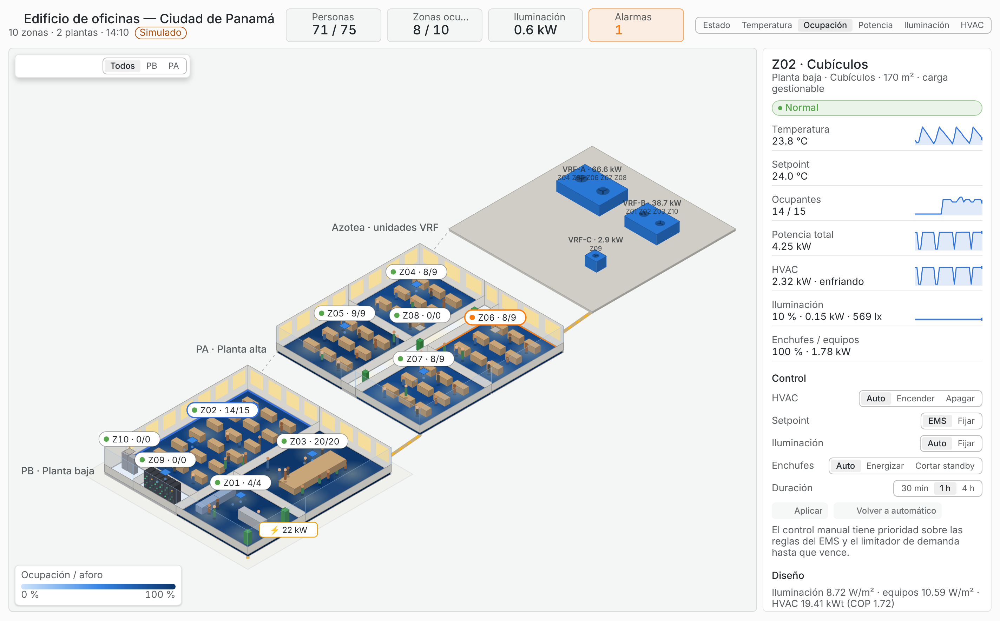
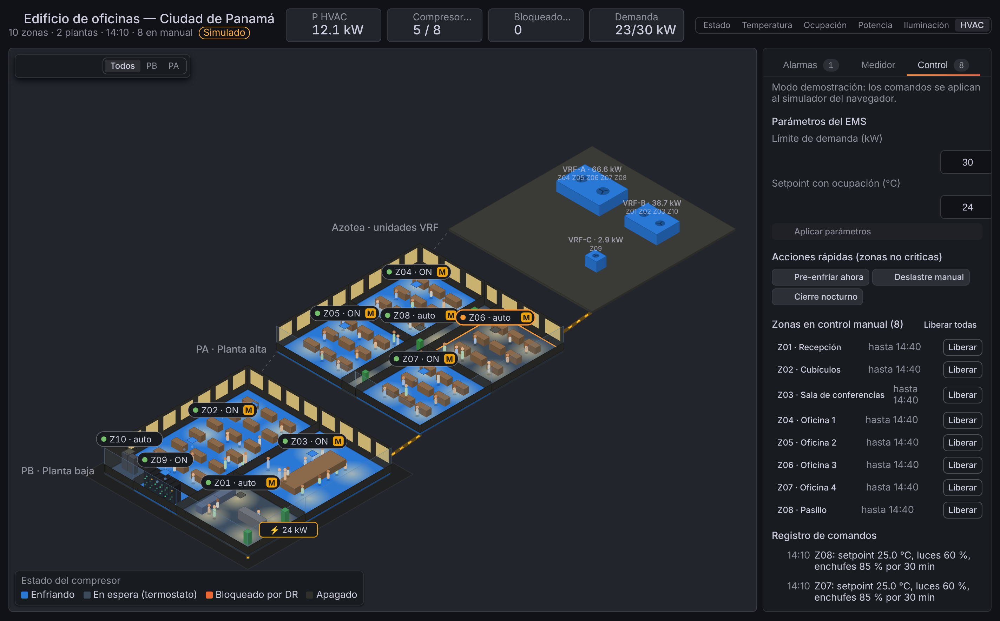

# EMS Edificio — panel de Grafana (`doctype02-ems-panel`)

Panel de Grafana con el **edificio inteligente del Proyecto 2 en 3D isométrico**, según el modelo
OpenStudio/EnergyPlus del equipo: 2 plantas de 20 × 20 m, 10 zonas y azotea con las 3 unidades exteriores VRF. Cada zona se colorea según la vista elegida y muestra el estado del
EMS (ocupación, HVAC, iluminación, potencia, alarmas). Reutiliza la base técnica del panel BMS
(`Doctype02/Plugin-BMS`): scaffolding de Grafana, encabezado de indicadores, insignias de estado,
sparklines y pantalla completa. El plano y los equipos son propios del edificio del EMS.


| Detalle y control de zona | Control del edificio (deslastre manual) |
|---|---|
|  |  |


## Qué muestra

- **Edificio 3D** (SVG, sin dependencias). Dos formas de verlo; se gira en pasos de 90° y se puede mostrar
  un solo piso (PB, P1, P2):
  - _En corte_ (vista explotada): cada piso escalonado, con muros de fondo completos y ventanas, fachada de
    vidrio con antepecho, divisiones bajas y el **interior de cada zona**: escritorios, mesa de reuniones,
    mesas de cafetería, mesones de laboratorio, filas de racks, gabinetes de UPS, recepción y sofás.
  - _Exterior_: pisos apilados con fachadas y ventanas.
- **Animaciones internas**:
  - personas sentadas en su puesto y ~30 % caminando hacia el pasillo y de regreso;
  - aire frío que baja de los difusores cuando el compresor enfría (difusor naranja y en pausa si el
    limitador de demanda lo bloquea);
  - halo de las luminarias según el nivel de dimerización;
  - LEDs de los racks parpadeando;
  - ventiladores de las unidades VRF girando (más rápido cuanto más potencia piden sus zonas);
  - montante eléctrica con flujo cuya velocidad sigue la potencia total.

  Botón ⏸ para pausarlas; se apagan solas con *prefers-reduced-motion*.
- **Seis vistas**:
  - _Estado_: verde, naranja, rojo o gris por zona; los críticos sin reconocer parpadean.
  - _Temperatura_: escala divergente respecto al setpoint (gris = dentro de ±0.5 °C).
  - _Ocupación_: personas sobre la planta.
  - _Potencia_: densidad en W/m².
  - _Iluminación_: nivel de dimerización.
  - _HVAC_: compresor enfriando, en espera, bloqueado por el limitador de demanda o apagado.
- Las **ventanas** se iluminan cuando la zona tiene luz encendida. Las **unidades VRF de la azotea** (VRF-A: oficinas y pasillo; VRF-B: recepción, cubículos, conferencias y cuarto eléctrico; VRF-C: servidores) se
  pintan de azul cuando alguna de sus zonas enfría y de naranja cuando el limitador de demanda (DR) tiene alguna en espera.
- **Encabezado**: cuatro indicadores por vista (potencia, demanda de 15 min frente al límite, personas,
  alarmas, FP, corriente, energía del día, …).
- **Panel lateral**:
  - _Alarmas_: se pueden reconocer una a una o todas.
  - _Medidor_: P, Q, S, FP, V, I, barra de demanda frente al límite y desglose por uso.
  - _Detalle de zona_: métricas con tendencias, parámetros de diseño y alarmas de la zona.

## Control del edificio

Requiere rol **Editor** o **Admin** en Grafana y la opción *Permitir control del edificio*.

- **Por zona** (en el detalle): HVAC auto/encender/apagar, setpoint fijo (20–28 °C), nivel de luces y
  corte de standby de enchufes, durante 30 min, 1 h o 4 h. El control manual tiene prioridad sobre las reglas
  del EMS y el limitador de demanda hasta que vence; *Volver a automático* lo libera. Las zonas en manual
  muestran una insignia **M**. Las zonas críticas (Z09, Z10) no se pueden controlar.
- **Del edificio** (pestaña *Control*): límite de demanda y setpoint con ocupación del EMS. Acciones rápidas:
  *Pre-enfriar ahora*, *Deslastre manual* y *Cierre nocturno*. Lista de zonas en manual con *Liberar*, y
  registro de comandos.
- **Modo demostración**: los comandos se aplican al simulador del navegador y el efecto se ve de inmediato
  (temperatura, potencia, demanda).
- **Modo en vivo**: el panel hace `POST` a *URL de control* (por defecto `http://localhost:1880/ems/control`).
  El flujo de Node-RED valida el comando, lo publica en `ems/edificio1/ems/override` o
  `…/ems/parametros` y sus reglas lo respetan. El navegador del usuario debe poder llegar a esa URL (CORS
  habilitado en el flujo). La duración de los overrides se cuenta en tiempo real del servidor.

## Modo demostración

Activado por defecto. Simula el edificio en el navegador con la misma lógica que el EMS en Python
(`ems/control.py`): ocupación por tipo de zona, setpoints por ocupación, pre-enfriamiento, termostato con
histéresis, luz natural, corte de standby y limitador de demanda. Con *Velocidad de simulación* = 60, un día
dura 24 minutos. Ocupación, iluminación y equipos siguen los horarios del modelo E+. Cada día laborable inyecta un incidente distinto para que se vean las alarmas:
- sensor congelado en los cubículos (Z02);
- falla del terminal VRF de la Oficina 3 (Z06);
- sala de conferencias (Z03) por encima de su aforo.

## Modo en vivo (InfluxDB)

Apague *Datos de demostración* y agregue estas consultas Flux al panel, con el datasource InfluxDB (Flux,
uid `ems-influx`). El esquema de datos está en [`../docs/CONTRATO.md`](../docs/CONTRATO.md). El panel acepta
tanto formato ancho (`pivot`) como largo (etiquetas `_field`/`_measurement`).

```flux
// A — zonas (último valor + tendencia para el detalle)
from(bucket: "ems")
  |> range(start: v.timeRangeStart, stop: v.timeRangeStop)
  |> filter(fn: (r) => r._measurement == "zona" and r.escenario == "live")
  |> aggregateWindow(every: 5m, fn: last, createEmpty: false)
  |> pivot(rowKey: ["_time", "zona"], columnKey: ["_field"], valueColumn: "_value")
  |> group()
```

```flux
// B — medidor general
from(bucket: "ems")
  |> range(start: v.timeRangeStart, stop: v.timeRangeStop)
  |> filter(fn: (r) => r._measurement == "medidor" and r.escenario == "live")
  |> aggregateWindow(every: 5m, fn: last, createEmpty: false)
  |> pivot(rowKey: ["_time"], columnKey: ["_field"], valueColumn: "_value")
  |> group()
```

```flux
// C — estado del EMS (DR, límite, latencia)
from(bucket: "ems")
  |> range(start: -1h)
  |> filter(fn: (r) => r._measurement == "ems" and r.escenario == "live")
  |> last()
  |> pivot(rowKey: ["_time"], columnKey: ["_field"], valueColumn: "_value")
  |> group()
```

```flux
// D — alarmas (se consideran activas las de la última hora)
from(bucket: "ems")
  |> range(start: -1h)
  |> filter(fn: (r) => r._measurement == "alarma" and r.escenario == "live")
  |> pivot(rowKey: ["_time", "zona", "codigo", "nivel"], columnKey: ["_field"], valueColumn: "_value")
  |> group()
```

Como el simulador corre más rápido que el reloj real, use el rango `now/d` → `now/d+1d`.

## Desarrollo

```bash
npm ci
```

```bash
npm run dev        # webpack en modo watch
```

```bash
npm run test:ci    # 35 pruebas unitarias (proyección, interiores, data frames, simulador, control)
```

```bash
npm run build      # dist/ listo para /var/lib/grafana/plugins/doctype02-ems-panel
```

```bash
npm run server     # Grafana de desarrollo con el dashboard aprovisionado (requiere Docker)
```

```bash
npm run e2e        # pruebas e2e con @grafana/plugin-e2e (requiere el servidor anterior)
```

El plugin no está firmado. Grafana debe permitirlo con
`GF_PLUGINS_ALLOW_LOADING_UNSIGNED_PLUGINS=doctype02-ems-panel`. Cualquier cambio en `src/plugin.json`
requiere reiniciar el servidor de Grafana.

| Archivo | Contenido |
|---|---|
| `src/building/model.ts` | Geometría del edificio: niveles, zonas y parámetros de diseño (iguales a `config/edificio.yaml`) |
| `src/building/iso.ts` | Proyección isométrica, rotación, vista explotada y orden de pintado |
| `src/building/telemetry.ts` | Tipos, lectura de data frames según el contrato y estado por zona |
| `src/building/simulator.ts` | Simulador determinista para el modo demostración |
| `src/building/views.ts` | Escalas de color, leyendas y rótulos por vista |
| `src/building/interior.ts` | Mobiliario, puestos, difusores y luminarias de cada zona |
| `src/building/control.ts` | Comandos del operador: validación, overrides locales y envío a Node-RED |
| `src/components/Building3D.tsx` | Escena SVG: pisos, vista exterior, montante eléctrica |
| `src/components/ZoneInterior.tsx` | Zona en corte con interiores y animaciones |
| `src/components/Rooftop.tsx` | Condensadoras con ventiladores animados |
| `src/components/ZoneControl.tsx`, `BuildingControl.tsx` | Controles por zona y del edificio |
| `src/components/EmsPanel.tsx` | Panel: encabezado, controles, panel lateral y tooltip |
