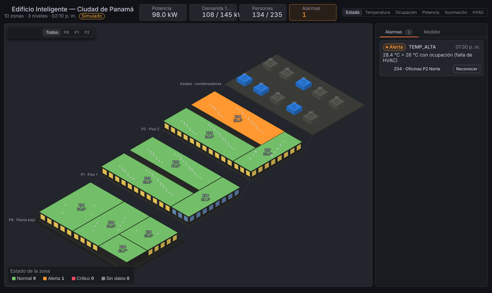
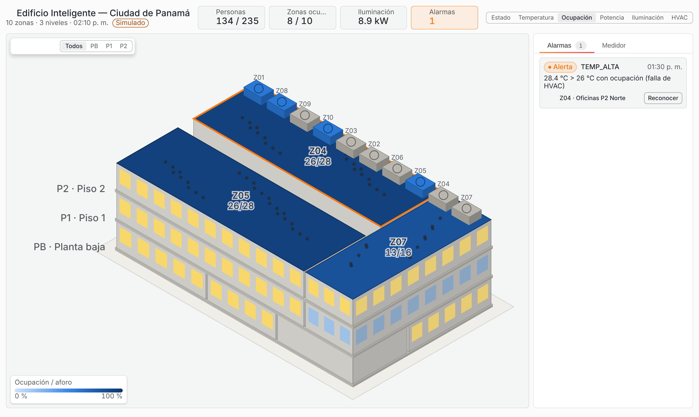
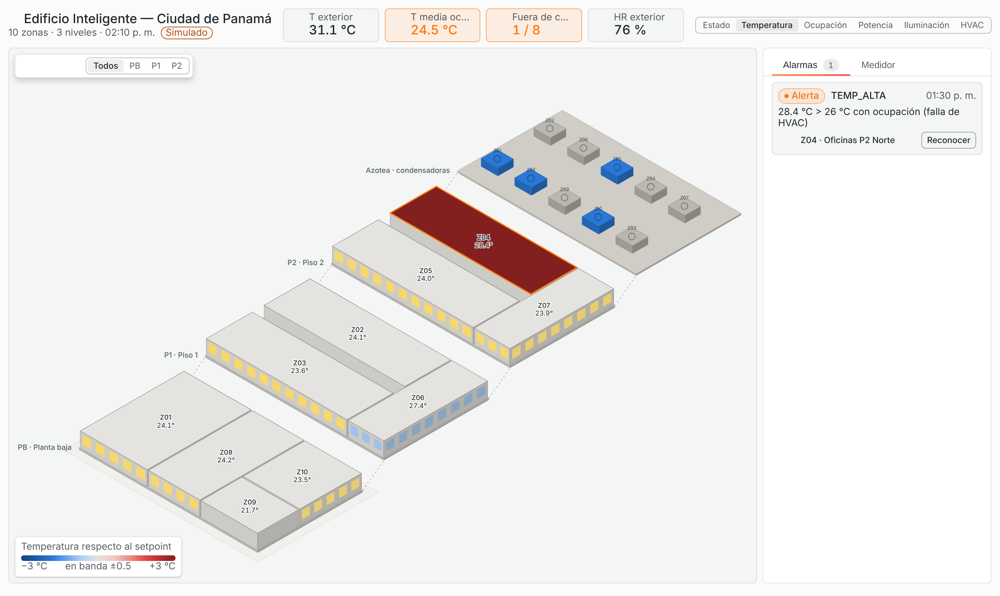

# EMS Edificio — panel de Grafana (`doctype02-ems-panel`)

Panel de Grafana con el **edificio inteligente del Proyecto 2 en 3D isométrico**: 3 niveles, 10 zonas y
azotea con las unidades condensadoras. Cada zona se colorea según la vista elegida y muestra el estado del
EMS (ocupación, HVAC, iluminación, potencia, alarmas). Reutiliza la base técnica del panel BMS
(`Doctype02/Plugin-BMS`): scaffolding de Grafana, encabezado de indicadores, insignias de estado,
sparklines y pantalla completa. El plano y los equipos son propios del edificio del EMS.



| Vista exterior (pisos apilados) | Temperatura respecto al setpoint |
|---|---|
|  |  |

## Qué muestra

- **Edificio 3D** (SVG, sin dependencias): vista *explotada* (cada piso escalonado para ver su planta
  completa, con la azotea como nivel propio) o *exterior* (pisos apilados con fachadas y ventanas). Se gira
  en pasos de 90° y se puede mostrar un solo piso (PB, P1, P2).
- **Seis vistas**:
  - _Estado_: verde, naranja, rojo o gris por zona; los críticos sin reconocer parpadean.
  - _Temperatura_: escala divergente respecto al setpoint (gris = dentro de ±0.5 °C).
  - _Ocupación_: personas sobre la planta.
  - _Potencia_: densidad en W/m².
  - _Iluminación_: nivel de dimerización.
  - _HVAC_: compresor enfriando, en espera, bloqueado por el limitador de demanda o apagado.
- Las **ventanas** se iluminan cuando la zona tiene luz encendida. Las **condensadoras de la azotea** se
  pintan de azul cuando su compresor enfría y de naranja cuando el limitador de demanda (DR) lo tiene en espera.
- **Encabezado**: cuatro indicadores por vista (potencia, demanda de 15 min frente al límite, personas,
  alarmas, FP, corriente, energía del día, …).
- **Panel lateral**:
  - _Alarmas_: se pueden reconocer una a una o todas.
  - _Medidor_: P, Q, S, FP, V, I, barra de demanda frente al límite y desglose por uso.
  - _Detalle de zona_: métricas con tendencias, parámetros de diseño y alarmas de la zona.

## Modo demostración

Activado por defecto. Simula el edificio en el navegador con la misma lógica que el EMS en Python
(`ems/control.py`): ocupación por tipo de zona, setpoints por ocupación, pre-enfriamiento, termostato con
histéresis, luz natural, corte de standby y limitador de demanda. Con *Velocidad de simulación* = 60, un día
dura 24 minutos. Cada día laborable inyecta un incidente distinto para que se vean las alarmas:
- sensor congelado en Z03;
- falla de HVAC en Z04;
- sala de conferencias Z06 por encima de su aforo.

## Modo en vivo (InfluxDB)

Apague *Datos de demostración* y agregue estas consultas Flux al panel, con el datasource InfluxDB (Flux,
uid `ems-influx`). El esquema de datos está en [`../docs/CONTRATO.md`](../docs/CONTRATO.md). El panel acepta
tanto formato ancho (`pivot`) como largo (etiquetas `_field`/`_measurement`).

```flux
// A — zonas (último valor + tendencia para el detalle)
from(bucket: "ems")
  |> range(start: v.timeRangeStart, stop: v.timeRangeStop)
  |> filter(fn: (r) => r._measurement == "zona" and r.escenario == "live")
  |> aggregateWindow(every: 5m, fn: last, createEmpty: false)
  |> pivot(rowKey: ["_time", "zona"], columnKey: ["_field"], valueColumn: "_value")
  |> group()
```

```flux
// B — medidor general
from(bucket: "ems")
  |> range(start: v.timeRangeStart, stop: v.timeRangeStop)
  |> filter(fn: (r) => r._measurement == "medidor" and r.escenario == "live")
  |> aggregateWindow(every: 5m, fn: last, createEmpty: false)
  |> pivot(rowKey: ["_time"], columnKey: ["_field"], valueColumn: "_value")
  |> group()
```

```flux
// C — estado del EMS (DR, límite, latencia)
from(bucket: "ems")
  |> range(start: -1h)
  |> filter(fn: (r) => r._measurement == "ems" and r.escenario == "live")
  |> last()
  |> pivot(rowKey: ["_time"], columnKey: ["_field"], valueColumn: "_value")
  |> group()
```

```flux
// D — alarmas (se consideran activas las de la última hora)
from(bucket: "ems")
  |> range(start: -1h)
  |> filter(fn: (r) => r._measurement == "alarma" and r.escenario == "live")
  |> pivot(rowKey: ["_time", "zona", "codigo", "nivel"], columnKey: ["_field"], valueColumn: "_value")
  |> group()
```

Como el simulador corre más rápido que el reloj real, use el rango `now/d` → `now/d+1d`.

## Desarrollo

```bash
npm ci
```

```bash
npm run dev        # webpack en modo watch
```

```bash
npm run test:ci    # 16 pruebas unitarias (proyección, lectura de data frames, simulador)
```

```bash
npm run build      # dist/ listo para /var/lib/grafana/plugins/doctype02-ems-panel
```

```bash
npm run server     # Grafana de desarrollo con el dashboard aprovisionado (requiere Docker)
```

```bash
npm run e2e        # pruebas e2e con @grafana/plugin-e2e (requiere el servidor anterior)
```

El plugin no está firmado. Grafana debe permitirlo con
`GF_PLUGINS_ALLOW_LOADING_UNSIGNED_PLUGINS=doctype02-ems-panel`. Cualquier cambio en `src/plugin.json`
requiere reiniciar el servidor de Grafana.

| Archivo | Contenido |
|---|---|
| `src/building/model.ts` | Geometría del edificio: niveles, zonas y parámetros de diseño (iguales a `config/edificio.yaml`) |
| `src/building/iso.ts` | Proyección isométrica, rotación, vista explotada y orden de pintado |
| `src/building/telemetry.ts` | Tipos, lectura de data frames según el contrato y estado por zona |
| `src/building/simulator.ts` | Simulador determinista para el modo demostración |
| `src/building/views.ts` | Escalas de color, leyendas y rótulos por vista |
| `src/components/Building3D.tsx` | Render SVG del edificio |
| `src/components/EmsPanel.tsx` | Panel: encabezado, controles, panel lateral y tooltip |
